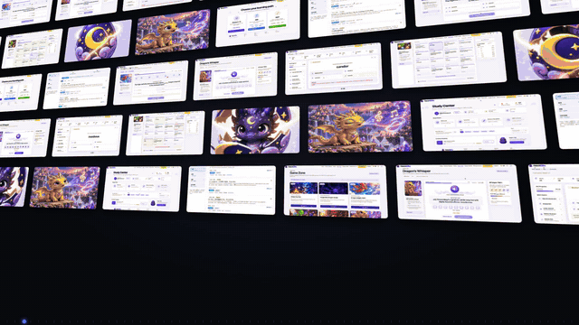
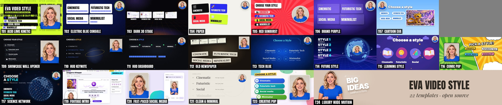

# EVA Video Style

**EVA Core + 23 independently installable video templates for AI-assisted talking-head editing.** Install Core once, add only the template ZIPs you want, then turn a raw MP4 into a planned, rendered and quality-checked video.

> **[Download the official EVA Video Style v1.0.0 Release](https://github.com/RoverEva/eva-video-style/releases/tag/v1.0.0)**
>
> Includes `EVA-Core.zip`, 23 individual template ZIPs, [`SHA256SUMS`](https://github.com/RoverEva/eva-video-style/releases/download/v1.0.0/SHA256SUMS) and [`download-manifest.json`](https://github.com/RoverEva/eva-video-style/releases/download/v1.0.0/download-manifest.json).



## Demos

Every demo is the same 15-second self-introduction by an AI-generated presenter, edited in a different template, so you can compare styles line by line.

- **Demo reel** (a different template on every line): [English](https://github.com/RoverEva/eva-video-style/releases/download/v1.0.0/Eva_Video_Style_Demo_Reel_EN.mp4) · [Chinese + English](https://github.com/RoverEva/eva-video-style/releases/download/v1.0.0/Eva_Video_Style_Demo_Reel_CN-EN.mp4)
- **Music montages**: [all 21 templates](https://github.com/RoverEva/eva-video-style/releases/download/v1.0.0/Eva_Video_Style_Montage.mp4) · [10-template cut](https://github.com/RoverEva/eva-video-style/releases/download/v1.0.0/Eva_Video_Style_Montage_2.mp4)

[](references/templates.md)

| ID | Template | Demo | Demo |
|---|---|---|---|
| T01 | Acid Lime Kinetic | [EN](https://github.com/RoverEva/eva-video-style/releases/download/v1.0.0/Eva_Template_T01_AcidLimeKinetic_EN.mp4) | [CN + EN](https://github.com/RoverEva/eva-video-style/releases/download/v1.0.0/Eva_Template_T01_AcidLimeKinetic_CN-EN.mp4) |
| T02 | Electric Blue Console | [EN](https://github.com/RoverEva/eva-video-style/releases/download/v1.0.0/Eva_Template_T02_ElectricBlueConsole_EN.mp4) | [CN + EN](https://github.com/RoverEva/eva-video-style/releases/download/v1.0.0/Eva_Template_T02_ElectricBlueConsole_CN-EN.mp4) |
| T03 | Dark 3D Stage | [EN](https://github.com/RoverEva/eva-video-style/releases/download/v1.0.0/Eva_Template_T03_Dark3DStage_EN.mp4) | [CN + EN](https://github.com/RoverEva/eva-video-style/releases/download/v1.0.0/Eva_Template_T03_Dark3DStage_CN-EN.mp4) |
| T04 | Paper | [EN](https://github.com/RoverEva/eva-video-style/releases/download/v1.0.0/Eva_Template_T04_Paper_EN.mp4) | [CN + EN](https://github.com/RoverEva/eva-video-style/releases/download/v1.0.0/Eva_Template_T04_Paper_CN-EN.mp4) |
| T05 | Red Sunburst | [EN](https://github.com/RoverEva/eva-video-style/releases/download/v1.0.0/Eva_Template_T05_RedSunburst_EN.mp4) | [CN + EN](https://github.com/RoverEva/eva-video-style/releases/download/v1.0.0/Eva_Template_T05_RedSunburst_CN-EN.mp4) |
| T06 | Brand Purple | [EN](https://github.com/RoverEva/eva-video-style/releases/download/v1.0.0/Eva_Template_T06_BrandPurple_EN.mp4) | [CN + EN](https://github.com/RoverEva/eva-video-style/releases/download/v1.0.0/Eva_Template_T06_BrandPurple_CN-EN.mp4) |
| T07 | Cartoon Eva | [EN](https://github.com/RoverEva/eva-video-style/releases/download/v1.0.0/Eva_Template_T07_CartoonEva_EN.mp4) | [CN + EN](https://github.com/RoverEva/eva-video-style/releases/download/v1.0.0/Eva_Template_T07_CartoonEva_CN-EN.mp4) |
| T08 | Neon Explainer | [EN](https://github.com/RoverEva/eva-video-style/releases/download/v1.0.0/Eva_Template_T08_NeonExplainer_EN.mp4) | [CN + EN](https://github.com/RoverEva/eva-video-style/releases/download/v1.0.0/Eva_Template_T08_NeonExplainer_CN-EN.mp4) |
| T09 | Showcase Wall Opener | [EN](https://github.com/RoverEva/eva-video-style/releases/download/v1.0.0/Eva_Template_T09_ShowcaseWall_EN.mp4) | [CN + EN](https://github.com/RoverEva/eva-video-style/releases/download/v1.0.0/Eva_Template_T09_ShowcaseWall_CN-EN.mp4) |
| T10 | HUD Keynote | [EN](https://github.com/RoverEva/eva-video-style/releases/download/v1.0.0/Eva_Template_T10_HUDKeynote_EN.mp4) | [CN + EN](https://github.com/RoverEva/eva-video-style/releases/download/v1.0.0/Eva_Template_T10_HUDKeynote_CN-EN.mp4) |
| T11 | HUD Dashboard | [EN](https://github.com/RoverEva/eva-video-style/releases/download/v1.0.0/Eva_Template_T11_HUDDashboard_EN.mp4) | [CN + EN](https://github.com/RoverEva/eva-video-style/releases/download/v1.0.0/Eva_Template_T11_HUDDashboard_CN-EN.mp4) |
| T12 | Old Newspaper | [EN](https://github.com/RoverEva/eva-video-style/releases/download/v1.0.0/Eva_Template_T12_OldNewspaper_EN.mp4) | [CN + EN](https://github.com/RoverEva/eva-video-style/releases/download/v1.0.0/Eva_Template_T12_OldNewspaper_CN-EN.mp4) |
| T13 | Tech Blue | [EN](https://github.com/RoverEva/eva-video-style/releases/download/v1.0.0/Eva_Template_T13_TechBlue_EN.mp4) | [CN + EN](https://github.com/RoverEva/eva-video-style/releases/download/v1.0.0/Eva_Template_T13_TechBlue_CN-EN.mp4) |
| T14 | Future Style | [EN](https://github.com/RoverEva/eva-video-style/releases/download/v1.0.0/Eva_Template_T14_FutureStyle_EN.mp4) | [CN + EN](https://github.com/RoverEva/eva-video-style/releases/download/v1.0.0/Eva_Template_T14_FutureStyle_CN-EN.mp4) |
| T15 | Learning Style | [EN](https://github.com/RoverEva/eva-video-style/releases/download/v1.0.0/Eva_Template_T15_LearningStyle_EN.mp4) | [CN + EN](https://github.com/RoverEva/eva-video-style/releases/download/v1.0.0/Eva_Template_T15_LearningStyle_CN-EN.mp4) |
| T16 | Comic Pop | [EN](https://github.com/RoverEva/eva-video-style/releases/download/v1.0.0/Eva_Template_T16_ComicPop_EN.mp4) | [CN + EN](https://github.com/RoverEva/eva-video-style/releases/download/v1.0.0/Eva_Template_T16_ComicPop_CN-EN.mp4) |
| T17 | Science Network | [EN](https://github.com/RoverEva/eva-video-style/releases/download/v1.0.0/Eva_Template_T17_ScienceNetwork_EN.mp4) | [CN + EN](https://github.com/RoverEva/eva-video-style/releases/download/v1.0.0/Eva_Template_T17_ScienceNetwork_CN-EN.mp4) |
| T19 | Footage Intro | [EN](https://github.com/RoverEva/eva-video-style/releases/download/v1.0.0/Eva_Template_T19_FootageIntro_EN.mp4) | [CN + EN](https://github.com/RoverEva/eva-video-style/releases/download/v1.0.0/Eva_Template_T19_FootageIntro_CN-EN.mp4) |
| T20 | Fast-Paced Social Media | [EN](https://github.com/RoverEva/eva-video-style/releases/download/v1.0.0/Eva_Template_T20_FastPacedSocial_EN.mp4) | [CN + EN](https://github.com/RoverEva/eva-video-style/releases/download/v1.0.0/Eva_Template_T20_FastPacedSocial_CN-EN.mp4) |
| T21 | Clean & Minimal | [EN](https://github.com/RoverEva/eva-video-style/releases/download/v1.0.0/Eva_Template_T21_CleanMinimal_EN.mp4) | [CN + EN](https://github.com/RoverEva/eva-video-style/releases/download/v1.0.0/Eva_Template_T21_CleanMinimal_CN-EN.mp4) |
| T23 | Creative Pop | [EN](https://github.com/RoverEva/eva-video-style/releases/download/v1.0.0/Eva_Template_T23_CreativePop_EN.mp4) | [CN + EN](https://github.com/RoverEva/eva-video-style/releases/download/v1.0.0/Eva_Template_T23_CreativePop_CN-EN.mp4) |
| T24 | Luxury Nude Motion | 5-second sample: [video](https://github.com/RoverEva/eva-video-style/releases/download/v1.0.0/Eva_Template_T24_LuxuryNude.mp4) | [frames](references/templates.md#t24--luxury-nude-motion) |

> The Demo section above is the original showcase and is preserved unchanged, including its historical template counts and presentation. The official v1.0.0 installable package inventory contains the 23 templates listed below.

```text
Install EVA Core once
        ↓
Add one or more TNN-1.0.0.zip template packages
        ↓
Raw MP4 ──→ ASR ──→ Content Planner ──→ Template Registry
  or SRT                                      ↓
Final MP4 ←── QA ←── full render ←── preview render
```

The v1.0.0 workflow is local and source-only. It does not require an EVA Video Studio account, billing service or private cloud API.

## What is in v1.0.0

- **EVA Core 1.0.0:** Skill, ASR adapter, Content Planner, Template Registry, Engine, Renderer, captions, installer and QA.
- **23 MIT/Free templates:** install, discover, combine and uninstall them independently.
- **Raw-MP4 automatic editing:** real transcription, timeline-aware planning, preview, final H.264/AAC render and QA.
- **Optional SRT input:** use an existing subtitle file and skip ASR.
- **16:9 and 9:16:** 22 templates support both formats. **T26 Vintage Story is 9:16 only.**
- **Current input duration:** 3–30.5 seconds. Sixty-second editing is not a v1.0.0 capability.

The release scope is T01–T07, T09–T17, T19–T21, T23–T24 and T26–T27. T08, T25 and T28 are excluded; T18 and T22 are retired and their IDs are not reused.

## v1.0.0 installable templates

This table is the current modular package inventory. The original showcase above remains unchanged, and no demo video or image was regenerated, deleted or overwritten.

| ID | Template | Formats | Existing preview | Package |
|---|---|---|---|---|
| T01 | Acid Lime Kinetic | 16:9, 9:16 | [Frame](references/samples/T01_a.jpg) | [T01-1.0.0.zip](https://github.com/RoverEva/eva-video-style/releases/download/v1.0.0/T01-1.0.0.zip) |
| T02 | Electric Blue Console | 16:9, 9:16 | [Frame](references/samples/T02_a.jpg) | [T02-1.0.0.zip](https://github.com/RoverEva/eva-video-style/releases/download/v1.0.0/T02-1.0.0.zip) |
| T03 | Dark 3D Stage | 16:9, 9:16 | [Frame](references/samples/T03_a.jpg) | [T03-1.0.0.zip](https://github.com/RoverEva/eva-video-style/releases/download/v1.0.0/T03-1.0.0.zip) |
| T04 | Paper | 16:9, 9:16 | [Frame](references/samples/T04_a.jpg) | [T04-1.0.0.zip](https://github.com/RoverEva/eva-video-style/releases/download/v1.0.0/T04-1.0.0.zip) |
| T05 | Red Sunburst | 16:9, 9:16 | [Frame](references/samples/T05_a.jpg) | [T05-1.0.0.zip](https://github.com/RoverEva/eva-video-style/releases/download/v1.0.0/T05-1.0.0.zip) |
| T06 | Brand Purple | 16:9, 9:16 | [Frame](references/samples/T06_a.jpg) | [T06-1.0.0.zip](https://github.com/RoverEva/eva-video-style/releases/download/v1.0.0/T06-1.0.0.zip) |
| T07 | Cartoon Eva | 16:9, 9:16 | [Frame](references/samples/T07_a.jpg) | [T07-1.0.0.zip](https://github.com/RoverEva/eva-video-style/releases/download/v1.0.0/T07-1.0.0.zip) |
| T09 | Showcase Wall Opener | 16:9, 9:16 | [Frame](references/samples/T09_a.jpg) | [T09-1.0.0.zip](https://github.com/RoverEva/eva-video-style/releases/download/v1.0.0/T09-1.0.0.zip) |
| T10 | HUD Keynote | 16:9, 9:16 | [Frame](references/samples/T10_a.jpg) | [T10-1.0.0.zip](https://github.com/RoverEva/eva-video-style/releases/download/v1.0.0/T10-1.0.0.zip) |
| T11 | HUD Dashboard | 16:9, 9:16 | [Frame](references/samples/T11_a.jpg) | [T11-1.0.0.zip](https://github.com/RoverEva/eva-video-style/releases/download/v1.0.0/T11-1.0.0.zip) |
| T12 | Old Newspaper | 16:9, 9:16 | [Frame](references/samples/T12_a.jpg) | [T12-1.0.0.zip](https://github.com/RoverEva/eva-video-style/releases/download/v1.0.0/T12-1.0.0.zip) |
| T13 | Tech Blue | 16:9, 9:16 | [Frame](references/samples/T13_a.jpg) | [T13-1.0.0.zip](https://github.com/RoverEva/eva-video-style/releases/download/v1.0.0/T13-1.0.0.zip) |
| T14 | Future Style | 16:9, 9:16 | [Frame](references/samples/T14_a.jpg) | [T14-1.0.0.zip](https://github.com/RoverEva/eva-video-style/releases/download/v1.0.0/T14-1.0.0.zip) |
| T15 | Learning Style | 16:9, 9:16 | [Frame](references/samples/T15_a.jpg) | [T15-1.0.0.zip](https://github.com/RoverEva/eva-video-style/releases/download/v1.0.0/T15-1.0.0.zip) |
| T16 | Comic Pop | 16:9, 9:16 | [Frame](references/samples/T16_a.jpg) | [T16-1.0.0.zip](https://github.com/RoverEva/eva-video-style/releases/download/v1.0.0/T16-1.0.0.zip) |
| T17 | Science Network | 16:9, 9:16 | [Frame](references/samples/T17_a.jpg) | [T17-1.0.0.zip](https://github.com/RoverEva/eva-video-style/releases/download/v1.0.0/T17-1.0.0.zip) |
| T19 | Footage Intro | 16:9, 9:16 | [Frame](references/samples/T19_a.jpg) | [T19-1.0.0.zip](https://github.com/RoverEva/eva-video-style/releases/download/v1.0.0/T19-1.0.0.zip) |
| T20 | Fast-Paced Social Media | 16:9, 9:16 | [Frame](references/samples/T20_a.jpg) | [T20-1.0.0.zip](https://github.com/RoverEva/eva-video-style/releases/download/v1.0.0/T20-1.0.0.zip) |
| T21 | Clean & Minimal | 16:9, 9:16 | [Frame](references/samples/T21_a.jpg) | [T21-1.0.0.zip](https://github.com/RoverEva/eva-video-style/releases/download/v1.0.0/T21-1.0.0.zip) |
| T23 | Creative Pop | 16:9, 9:16 | [Frame](references/samples/T23_a.jpg) | [T23-1.0.0.zip](https://github.com/RoverEva/eva-video-style/releases/download/v1.0.0/T23-1.0.0.zip) |
| T24 | Luxury Nude Motion | 16:9, 9:16 | [Frame](references/samples/T24_a.jpg) | [T24-1.0.0.zip](https://github.com/RoverEva/eva-video-style/releases/download/v1.0.0/T24-1.0.0.zip) |
| T26 | **Vintage Story / 复古拼贴故事** | **9:16 only** | Public demo not included | [T26-1.0.0.zip](https://github.com/RoverEva/eva-video-style/releases/download/v1.0.0/T26-1.0.0.zip) |
| T27 | Video Wall Kinetic Typography | 16:9, 9:16 | Public demo not included | [T27-1.0.0.zip](https://github.com/RoverEva/eva-video-style/releases/download/v1.0.0/T27-1.0.0.zip) |

## Quick installation

Requirements: Node 20+, Python 3.10–3.13, a Chromium-compatible browser, and FFmpeg with libx264, AAC and libass/subtitles support. Some templates require host-installed fonts or optional dependencies documented in their ZIP.

Download Core, the checksum list and one or more template packages from the [v1.0.0 Release](https://github.com/RoverEva/eva-video-style/releases/tag/v1.0.0). For example:

```sh
RELEASE_BASE="https://github.com/RoverEva/eva-video-style/releases/download/v1.0.0"
curl -LO "$RELEASE_BASE/EVA-Core.zip"
curl -LO "$RELEASE_BASE/T01-1.0.0.zip"
curl -LO "$RELEASE_BASE/SHA256SUMS"

grep -E '  (EVA-Core.zip|T01-1.0.0.zip)$' SHA256SUMS | shasum -a 256 -c -

mkdir eva-video-style
unzip EVA-Core.zip -d eva-video-style
cd eva-video-style/EVA-Core

python3 -m venv .venv
.venv/bin/pip install -r requirements-core.txt
npm ci

.venv/bin/python tools/packages/install.py \
  --root .. install-template ../../T01-1.0.0.zip \
  --id T01 --version 1.0.0
```

The raw-MP4 path uses `eva-asr` at the exact revision recorded in `EVA-Core/core.lock.json`. Keep its locked environment separate from the Core environment to avoid Torch/TorchAudio/TorchCodec/FFmpeg ABI conflicts. See the [complete independent-Core guide](https://github.com/RoverEva/eva-video-style/blob/v1.0.0/EVA-Core/docs/independent-core.md) for the reproducible ASR setup.

## Automatic editing

Run from the installed `EVA-Core` directory:

```sh
.venv/bin/python core/pipeline.py edit raw/talk.mp4 jobs/t01 \
  --install-root .. \
  --templates T01 \
  --aspect 9:16 \
  --asr-python ../../eva-asr/.venv/bin/python
```

This runs transcription, content planning, Registry compatibility checks, a watermarked preview, the full-resolution render and QA. To use existing subtitles, add `--srt raw/talk.srt`; ASR is then skipped. Compatible installed templates can be combined with `--templates T01,T17 --mode multi`.

Core accepts inputs from **3 to 30.5 seconds**. It rejects unsupported durations or aspect ratios instead of silently truncating or changing them. T26 must be requested with `--aspect 9:16`.

## Modular architecture

| Component | Responsibility |
|---|---|
| `EVA-Core.zip` | Skill, ASR/SRT ingestion, Planner, Template Registry, shared Engine, Renderer, captions, installer and QA |
| `TNN-1.0.0.zip` | One template's code, configuration, metadata, dependency declaration and distributable assets |
| Template Registry | Stable IDs and versions, compatibility, aspect ratios, dependency checks and installed-template discovery |
| Local pipeline | Raw MP4/SRT → plan → preview → final render → QA report and final MP4 |

Core never selects an uninstalled template. Template packages do not duplicate the shared engine, ASR or QA implementation. Use [`download-manifest.json`](https://github.com/RoverEva/eva-video-style/releases/download/v1.0.0/download-manifest.json) to automate selective downloads.

The `main` branch retains the project's original development toolkit and existing reference assets. The official modular v1.0.0 source and packages are frozen at the [`v1.0.0` tag](https://github.com/RoverEva/eva-video-style/tree/v1.0.0); this README update does not replace or rewrite `main` history.

## EVA Video Studio is separate

EVA Video Studio is a separate online product. The open-source v1.0.0 Release contains no Studio account, payment, private service or deployment code, and installing EVA Core does not connect to or deploy Studio.

## Principles

- Keep the speaker's face safely framed.
- Time graphics and captions to real speech rather than invented timing.
- Do not invent facts, numbers or screens; label conceptual material **ILLUSTRATIVE**.
- Preserve source files and user media; never overwrite inputs.
- Treat QA warnings as review items rather than silently ignoring them.

## License

[MIT](LICENSE) © 2026 RoverEva. Bundled fonts retain their SIL Open Font License 1.1 notices. Optional host-installed software, ASR/model downloads and user-provided media retain their respective licenses; see the [v1.0.0 third-party notices](https://github.com/RoverEva/eva-video-style/blob/v1.0.0/THIRD_PARTY_NOTICES.md).
