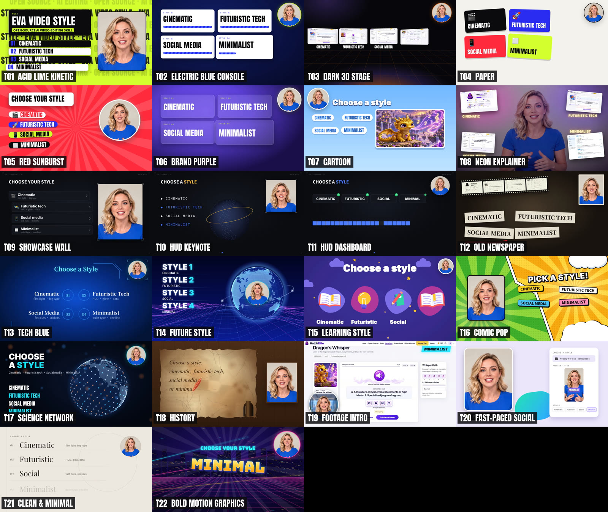

# Eva Video Style

**An open-source AI video-editing skill for talking-head videos.** Give Claude a raw recording plus its subtitles, pick a style, and get back a finished, motion-designed video with captions in English, or in Chinese and English.

Twenty-two ready-to-use templates cover cinematic, futuristic tech, social media and minimalist looks. Every frame is rendered from code, so results are deterministic and editable.


## Demos

Every demo is the same 15-second self-introduction by an AI-generated presenter, edited in a different template, so you can compare styles line by line.

- **Demo reel** (a different template on every line): [English](https://github.com/RoverEva/eva-video-style/releases/download/v1.0.0/Eva_Video_Style_Demo_Reel_EN.mp4) · [Chinese + English](https://github.com/RoverEva/eva-video-style/releases/download/v1.0.0/Eva_Video_Style_Demo_Reel_CN-EN.mp4)
- **Music montages**: [all 21 templates](https://github.com/RoverEva/eva-video-style/releases/download/v1.0.0/Eva_Video_Style_Montage.mp4) · [10-template cut](https://github.com/RoverEva/eva-video-style/releases/download/v1.0.0/Eva_Video_Style_Montage_2.mp4)

[](references/templates.md)

| ID | Template | Demo | Demo |
|---|---|---|---|
| T01 | Acid Lime Kinetic | [EN](https://github.com/RoverEva/eva-video-style/releases/download/v1.0.0/Eva_Template_T01_AcidLimeKinetic_EN.mp4) | [CN + EN](https://github.com/RoverEva/eva-video-style/releases/download/v1.0.0/Eva_Template_T01_AcidLimeKinetic_CN-EN.mp4) |
| T02 | Electric Blue Console | [EN](https://github.com/RoverEva/eva-video-style/releases/download/v1.0.0/Eva_Template_T02_ElectricBlueConsole_EN.mp4) | [CN + EN](https://github.com/RoverEva/eva-video-style/releases/download/v1.0.0/Eva_Template_T02_ElectricBlueConsole_CN-EN.mp4) |
| T03 | Dark 3D Stage | [EN](https://github.com/RoverEva/eva-video-style/releases/download/v1.0.0/Eva_Template_T03_Dark3DStage_EN.mp4) | [CN + EN](https://github.com/RoverEva/eva-video-style/releases/download/v1.0.0/Eva_Template_T03_Dark3DStage_CN-EN.mp4) |
| T04 | Paper | [EN](https://github.com/RoverEva/eva-video-style/releases/download/v1.0.0/Eva_Template_T04_Paper_EN.mp4) | [CN + EN](https://github.com/RoverEva/eva-video-style/releases/download/v1.0.0/Eva_Template_T04_Paper_CN-EN.mp4) |
| T05 | Red Sunburst | [EN](https://github.com/RoverEva/eva-video-style/releases/download/v1.0.0/Eva_Template_T05_RedSunburst_EN.mp4) | [CN + EN](https://github.com/RoverEva/eva-video-style/releases/download/v1.0.0/Eva_Template_T05_RedSunburst_CN-EN.mp4) |
| T06 | Brand Purple | [EN](https://github.com/RoverEva/eva-video-style/releases/download/v1.0.0/Eva_Template_T06_BrandPurple_EN.mp4) | [CN + EN](https://github.com/RoverEva/eva-video-style/releases/download/v1.0.0/Eva_Template_T06_BrandPurple_CN-EN.mp4) |
| T07 | Cartoon Eva | [EN](https://github.com/RoverEva/eva-video-style/releases/download/v1.0.0/Eva_Template_T07_CartoonEva_EN.mp4) | [CN + EN](https://github.com/RoverEva/eva-video-style/releases/download/v1.0.0/Eva_Template_T07_CartoonEva_CN-EN.mp4) |
| T08 | Neon Explainer | [EN](https://github.com/RoverEva/eva-video-style/releases/download/v1.0.0/Eva_Template_T08_NeonExplainer_EN.mp4) | [CN + EN](https://github.com/RoverEva/eva-video-style/releases/download/v1.0.0/Eva_Template_T08_NeonExplainer_CN-EN.mp4) |
| T09 | Showcase Wall Opener | [EN](https://github.com/RoverEva/eva-video-style/releases/download/v1.0.0/Eva_Template_T09_ShowcaseWall_EN.mp4) | [CN + EN](https://github.com/RoverEva/eva-video-style/releases/download/v1.0.0/Eva_Template_T09_ShowcaseWall_CN-EN.mp4) |
| T10 | HUD Keynote | [EN](https://github.com/RoverEva/eva-video-style/releases/download/v1.0.0/Eva_Template_T10_HUDKeynote_EN.mp4) | [CN + EN](https://github.com/RoverEva/eva-video-style/releases/download/v1.0.0/Eva_Template_T10_HUDKeynote_CN-EN.mp4) |
| T11 | HUD Dashboard | [EN](https://github.com/RoverEva/eva-video-style/releases/download/v1.0.0/Eva_Template_T11_HUDDashboard_EN.mp4) | [CN + EN](https://github.com/RoverEva/eva-video-style/releases/download/v1.0.0/Eva_Template_T11_HUDDashboard_CN-EN.mp4) |
| T12 | Old Newspaper | [EN](https://github.com/RoverEva/eva-video-style/releases/download/v1.0.0/Eva_Template_T12_OldNewspaper_EN.mp4) | [CN + EN](https://github.com/RoverEva/eva-video-style/releases/download/v1.0.0/Eva_Template_T12_OldNewspaper_CN-EN.mp4) |
| T13 | Tech Blue | [EN](https://github.com/RoverEva/eva-video-style/releases/download/v1.0.0/Eva_Template_T13_TechBlue_EN.mp4) | [CN + EN](https://github.com/RoverEva/eva-video-style/releases/download/v1.0.0/Eva_Template_T13_TechBlue_CN-EN.mp4) |
| T14 | Future Style | [EN](https://github.com/RoverEva/eva-video-style/releases/download/v1.0.0/Eva_Template_T14_FutureStyle_EN.mp4) | [CN + EN](https://github.com/RoverEva/eva-video-style/releases/download/v1.0.0/Eva_Template_T14_FutureStyle_CN-EN.mp4) |
| T15 | Learning Style | [EN](https://github.com/RoverEva/eva-video-style/releases/download/v1.0.0/Eva_Template_T15_LearningStyle_EN.mp4) | [CN + EN](https://github.com/RoverEva/eva-video-style/releases/download/v1.0.0/Eva_Template_T15_LearningStyle_CN-EN.mp4) |
| T16 | Comic Pop | [EN](https://github.com/RoverEva/eva-video-style/releases/download/v1.0.0/Eva_Template_T16_ComicPop_EN.mp4) | [CN + EN](https://github.com/RoverEva/eva-video-style/releases/download/v1.0.0/Eva_Template_T16_ComicPop_CN-EN.mp4) |
| T17 | Science Network | [EN](https://github.com/RoverEva/eva-video-style/releases/download/v1.0.0/Eva_Template_T17_ScienceNetwork_EN.mp4) | [CN + EN](https://github.com/RoverEva/eva-video-style/releases/download/v1.0.0/Eva_Template_T17_ScienceNetwork_CN-EN.mp4) |
| T19 | Footage Intro | [EN](https://github.com/RoverEva/eva-video-style/releases/download/v1.0.0/Eva_Template_T19_FootageIntro_EN.mp4) | [CN + EN](https://github.com/RoverEva/eva-video-style/releases/download/v1.0.0/Eva_Template_T19_FootageIntro_CN-EN.mp4) |
| T20 | Fast-Paced Social Media | [EN](https://github.com/RoverEva/eva-video-style/releases/download/v1.0.0/Eva_Template_T20_FastPacedSocial_EN.mp4) | [CN + EN](https://github.com/RoverEva/eva-video-style/releases/download/v1.0.0/Eva_Template_T20_FastPacedSocial_CN-EN.mp4) |
| T21 | Clean & Minimal | [EN](https://github.com/RoverEva/eva-video-style/releases/download/v1.0.0/Eva_Template_T21_CleanMinimal_EN.mp4) | [CN + EN](https://github.com/RoverEva/eva-video-style/releases/download/v1.0.0/Eva_Template_T21_CleanMinimal_CN-EN.mp4) |
| T23 | Creative Pop | [EN](https://github.com/RoverEva/eva-video-style/releases/download/v1.0.0/Eva_Template_T23_CreativePop_EN.mp4) | [CN + EN](https://github.com/RoverEva/eva-video-style/releases/download/v1.0.0/Eva_Template_T23_CreativePop_CN-EN.mp4) |
| T24 | Luxury Nude Motion | 5-second sample: [video](https://github.com/RoverEva/eva-video-style/releases/download/v1.0.0/Eva_Template_T24_LuxuryNude.mp4) | [frames](references/templates.md#t24--luxury-nude-motion) |

## What it does

- **A presenter window that keeps moving.** Full-bleed → card → circle, with face-safe framing: the speaker's whole head is always visible.
- **Kinetic graphics timed to the words.** Cards, giant type, stickers, gauges, maps and real screen recordings pop in exactly when they are said.
- **22 named templates (T01–T21, T23 and T24).** From Acid Lime Kinetic and Electric Blue Console to Old Newspaper, Science Network, Footage Intro, Fast-Paced Social, Clean & Minimal the Creative Pop seven-colour card system and the new Luxury Nude Motion (3D white type and ivory cards on a nude stage). (T18 and T22 were retired; the other IDs stay the same.) See [`references/templates.md`](references/templates.md).
- **Captions your way.** English-only, or bilingual (Chinese line on top, English underneath). Machine-translation slips are fixed in the burned captions only, and your SRT is never edited. On footage-heavy shots, captions move to the clearest part of the frame.
- **Real footage, handled properly (T19).** AI cut-out of the speaker (natural colours), fast swaps through backgrounds you import (your own images or footage; no images are bundled), the clip pushes in, the presenter shrinks into a circle that stays clear of the action.
- **Clean sound.** No background music: the original voice plus short sound effects, normalised to about -16 LUFS.

## Use it as a Claude skill

1. Copy this folder into your skills directory (for example `~/.claude/skills/eva-video-style/`), or upload it as a custom skill.
2. Ask: *"Edit this video in Eva Video Style"*, and attach the raw video plus an SRT (English, or bilingual Chinese + English).
3. Name templates if you like (*"use T19 for the news clips and T21 for the summary"*), or let Claude pick per section.

## Use the toolkit directly

Requirements: Node 18+, Python 3 with `numpy` (plus `opencv-python` and `onnxruntime` for T19), FFmpeg with libx264 and libass, and the system fonts listed in [`engine/fonts/README.md`](engine/fonts/README.md).

```bash
npm install && npx playwright install chromium
pip install numpy opencv-python onnxruntime

scripts/extract_frames.sh my_talk.mp4 media/eva                                  # speaker as 30 fps frames
node scripts/render.mjs template/section/index.html --stills check --times 1,4,8  # layout check
node scripts/render.mjs template/section/index.html --out sec/s1.mp4             # silent render
python3 scripts/captions.py my_talk.srt 0 99999 out/my_talk config.json          # captions (.srt + .ass)
```

### No SRT yet? Recognise the speech with eva-asr

[eva-asr](https://github.com/RoverEva/eva-asr) (WhisperX-based) can produce the subtitles from the raw video. `scripts/asr.py` calls eva-asr's library API (transcription, wav2vec2 word alignment, and its translate task for the English line) and writes a bilingual SRT in exactly the format `captions.py` reads, plus word timings for `scenes.js`.

```bash
git clone https://github.com/RoverEva/eva-asr && pip install -e eva-asr     # torch, faster-whisper, … (CPU: add --extra-index-url https://download.pytorch.org/whl/cpu)
cp config/asr.example.json srt/asr.json                                     # model, device, language, translate, align …
python3 scripts/asr.py raw/talk.mp4 srt/talk --config srt/asr.json          # -> srt/talk.{zh,en,bilingual}.srt, .asr.json, .transcript.js
python3 scripts/captions.py srt/talk.bilingual.srt 0 99999 out/NAME_CN-EN   # unchanged caption step
# or both at once: scripts/asr_captions.sh raw/talk.mp4 srt/talk out/NAME_CN-EN srt/asr.json [display_fix.json]
```

Without a local checkout installed, set `eva_asr_path` in the config (or `EVA_ASR_PATH`). The first run downloads the Whisper and alignment models from Hugging Face; offline machines can point `model` / `model_dir` at local copies and set `model_cache_only`. Exit codes: 1 would overwrite, 2 bad input/config, 3 eva-asr or its dependencies missing, 4 model or inference failure, 5 no speech. Machine-recognised text can be wrong: review the SRT and correct burned lines through `display_fix.json` as usual. Tests: `python3 -m pytest tests` and `node tests/test_asr_js.mjs`.

The full workflow, from raw video to delivered master, is in [`references/pipeline.md`](references/pipeline.md). The engine API is in [`references/engine-api.md`](references/engine-api.md), and the look and rules are in [`references/style-guide.md`](references/style-guide.md).

## Repository layout

| Path | What it is |
|---|---|
| `SKILL.md` | Skill entry point: rules, deliverables, quick start |
| `engine/` | Small deterministic HTML motion engine: presenter window, scenes, design kit, template helpers, fonts |
| `template/` | A starter section (`section/`) plus a full demo section for every template (`demo/t01` … `demo/t23`) |
| `scripts/` | Frame extraction, Playwright renderer, sound effects, captions, caption placement, AI cut-out, assembly, contact sheets, eva-asr speech recognition (`asr.py`, `asr_captions.sh`) |
| `config/` | Example eva-asr config (`asr.example.json`) |
| `tests/` | Tests for the eva-asr integration |
| `references/` | Style guide, pipeline, engine API, template library with sample frames |

## Principles

- The speaker's whole head is always visible; the window never crops the face.
- No background music in talking-head edits: the original voice plus short sound effects. (The music montages above are separate showcase pieces.)
- No invented facts, numbers or screens. Anything conceptual is labelled **ILLUSTRATIVE**.
- Source files and earlier versions are never overwritten.

## License

[MIT](LICENSE) © 2026 RoverEva. Bundled fonts are under the SIL Open Font License 1.1 (see `engine/fonts/licenses/`). The optional T19 cut-out model ([Robust Video Matting](https://github.com/PeterL1n/RobustVideoMatting), GPL-3.0) is downloaded on first use and is not part of this repository.

## Credits

`engine/land.js` (the globe land mask) is rasterised from [johan/world.geo.json](https://github.com/johan/world.geo.json), public domain, based on Natural Earth. Demo presenter: an AI-generated model. Screen recordings in the demos are from HatchElite, the author's own learning app; the montage music and the cartoon clips are the author's own material, included for the demos only.
