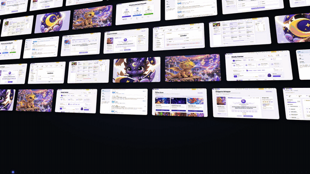
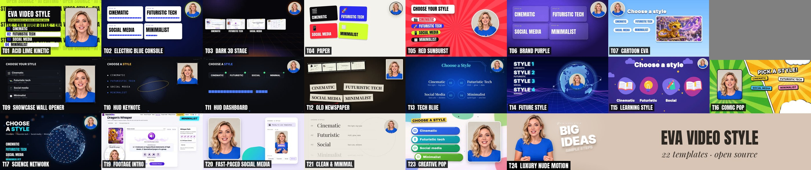

# EVA Video Style

**Open-Source AI Video Editing | 开源 AI 自动视频剪辑**

Turn raw talking-head videos into professionally edited content with motion graphics, captions and quality checks.

将原始口播视频转换为包含专业动效、字幕和质量检测的成片。

**23 Modular Templates · AI-Powered Editing · MIT Licensed**

> **[Download EVA Video Style v1.0.1 | 下载正式版](https://github.com/RoverEva/eva-video-style/releases/tag/v1.0.1)**

## Get Started | 快速开始

| EVA Core — Required / 核心引擎（必装） | 23 Templates — Optional / 视频模板（按需安装） |
|---|---|
| **`EVA-Core.zip`** · download once / 只需下载一次 | **`TNN-1.0.0.zip`** · choose the styles you need / 按需选择 |
| ASR, AI Content Planner, Template Registry, Renderer, captions and QA | Template-owned animations, layouts, configuration and distributable assets |
| 语音识别、AI 内容规划、模板注册表、渲染、字幕与质量检测 | 每套模板独立包含视觉布局、动画、配置及可分发素材 |
| **[Download EVA-Core.zip](https://github.com/RoverEva/eva-video-style/releases/download/v1.0.1/EVA-Core.zip)** | **[Browse all 23 template ZIPs](https://github.com/RoverEva/eva-video-style/releases/tag/v1.0.1)** |

**Install Core once → Download selected templates → Add a raw MP4 → AI automatic editing**

**安装一次 Core → 按需选择模板 → 输入原始 MP4 → AI 自动剪辑**

```text
Raw MP4 / optional SRT
        ↓
ASR → AI Content Planner → installed Template Registry
        ↓
Preview → Final Renderer → QA → Final MP4
```

### Automatic editing | AI 自动剪辑

Select one or more compatible installed templates. EVA Core transcribes the video (or reads an existing SRT), plans scenes against the real timeline, renders a preview and final video, then runs QA.

选择一个或多个兼容且已安装的模板。EVA Core 会识别语音（或读取已有 SRT）、根据真实时间轴规划分镜、生成预览和最终视频，并完成质量检测。

EVA Core supports:

- complete input videos of any length (minimum 3 seconds) — no fixed duration limit; long videos render in 10-second chunks with continuous audio and captions (Core 1.0.1 removes the 30.5-second limit that v1.0.0 wrongly inherited from the hosted Studio)
- 16:9 and 9:16 where declared by the template; T26 is 9:16 only
- automatic ASR or an existing SRT
- compatible multi-template editing
- local rendering with no Studio account, billing service or private cloud API

EVA Core 支持完整长度的视频（至少 3 秒，无固定时长上限）、自动语音识别或已有字幕、兼容模板组合及本地渲染。Core 1.0.1 移除了 v1.0.0 误用的 30.5 秒限制（该限制仅属于托管版 EVA Video Studio 的首发策略）。

## Demo Showcase | 视频效果展示



Explore the original showcase using the same AI-generated presenter. The table below contains 21 historical demo styles; labels embedded in the preserved GIF and collage may reflect earlier snapshot counts. This showcase is separate from the current 23-template modular package inventory.

使用相同的 AI 虚拟人物和口播内容，对比表格中的 21 种历史视觉效果。保留的 GIF 和拼图中可能仍显示旧版本数量；历史 Demo 展示与当前正式发布的 23 套可安装模板是两个不同范围。

- **Demo Reel / 演示合集:** English and Chinese + English MP4 files are preserved; **public hosting pending**.
- **Music Montages / 音乐合集:** 21-template and 10-template MP4 files are preserved; **public hosting pending**.

The former `v1.0.0/...mp4` URLs were removed because the official v1.0.0 Release contains ZIP and manifest assets only. No replacement URL is listed until a durable public host is verified.

原来的 `v1.0.0/...mp4` 地址并不是正式 Release 资产，因此已移除失效链接。确认长期有效的公开托管地址前，不提供未经验证的视频 URL。

[](references/templates.md)

| ID | Historical demo / 历史演示 | Public preview / 公开预览 |
|---|---|---|
| T01 | Acid Lime Kinetic · EN + CN/EN MP4 | [Frame](references/samples/T01_a.jpg) · video hosting pending |
| T02 | Electric Blue Console · EN + CN/EN MP4 | [Frame](references/samples/T02_a.jpg) · video hosting pending |
| T03 | Dark 3D Stage · EN + CN/EN MP4 | [Frame](references/samples/T03_a.jpg) · video hosting pending |
| T04 | Paper · EN + CN/EN MP4 | [Frame](references/samples/T04_a.jpg) · video hosting pending |
| T05 | Red Sunburst · EN + CN/EN MP4 | [Frame](references/samples/T05_a.jpg) · video hosting pending |
| T06 | Brand Purple · EN + CN/EN MP4 | [Frame](references/samples/T06_a.jpg) · video hosting pending |
| T07 | Cartoon Eva · EN + CN/EN MP4 | [Frame](references/samples/T07_a.jpg) · video hosting pending |
| T09 | Showcase Wall Opener · EN + CN/EN MP4 | [Frame](references/samples/T09_a.jpg) · video hosting pending |
| T10 | HUD Keynote · EN + CN/EN MP4 | [Frame](references/samples/T10_a.jpg) · video hosting pending |
| T11 | HUD Dashboard · EN + CN/EN MP4 | [Frame](references/samples/T11_a.jpg) · video hosting pending |
| T12 | Old Newspaper · EN + CN/EN MP4 | [Frame](references/samples/T12_a.jpg) · video hosting pending |
| T13 | Tech Blue · EN + CN/EN MP4 | [Frame](references/samples/T13_a.jpg) · video hosting pending |
| T14 | Future Style · EN + CN/EN MP4 | [Frame](references/samples/T14_a.jpg) · video hosting pending |
| T15 | Learning Style · EN + CN/EN MP4 | [Frame](references/samples/T15_a.jpg) · video hosting pending |
| T16 | Comic Pop · EN + CN/EN MP4 | [Frame](references/samples/T16_a.jpg) · video hosting pending |
| T17 | Science Network · EN + CN/EN MP4 | [Frame](references/samples/T17_a.jpg) · video hosting pending |
| T19 | Footage Intro · EN + CN/EN MP4 | [Frame](references/samples/T19_a.jpg) · video hosting pending |
| T20 | Fast-Paced Social Media · EN + CN/EN MP4 | [Frame](references/samples/T20_a.jpg) · video hosting pending |
| T21 | Clean & Minimal · EN + CN/EN MP4 | [Frame](references/samples/T21_a.jpg) · video hosting pending |
| T23 | Creative Pop · EN + CN/EN MP4 | [Frame](references/samples/T23_a.jpg) · video hosting pending |
| T24 | Luxury Nude Motion · 5-second MP4 | [Frame](references/samples/T24_a.jpg) · video hosting pending |

T08 remains excluded from the showcase and v1.0.0 package set. T26 and T27 are not represented as public demos.

T08 继续排除在展示和 v1.0.0 安装包之外；T26、T27 暂不标注为已有公开 Demo。

## Available Templates | 已发布模板

All 23 templates are MIT-licensed, Free and independently installable. Download only the ZIPs you need.

23 套模板均为 MIT 开源授权，可免费独立安装并按需下载。

| ID | Template / 模板 | Supported formats | ZIP |
|---|---|---|---|
| T01 | Acid Lime Kinetic | 16:9 / 9:16 | [Download](https://github.com/RoverEva/eva-video-style/releases/download/v1.0.1/T01-1.0.0.zip) |
| T02 | Electric Blue Console | 16:9 / 9:16 | [Download](https://github.com/RoverEva/eva-video-style/releases/download/v1.0.1/T02-1.0.0.zip) |
| T03 | Dark 3D Stage | 16:9 / 9:16 | [Download](https://github.com/RoverEva/eva-video-style/releases/download/v1.0.1/T03-1.0.0.zip) |
| T04 | Paper | 16:9 / 9:16 | [Download](https://github.com/RoverEva/eva-video-style/releases/download/v1.0.1/T04-1.0.0.zip) |
| T05 | Red Sunburst | 16:9 / 9:16 | [Download](https://github.com/RoverEva/eva-video-style/releases/download/v1.0.1/T05-1.0.0.zip) |
| T06 | Brand Purple | 16:9 / 9:16 | [Download](https://github.com/RoverEva/eva-video-style/releases/download/v1.0.1/T06-1.0.0.zip) |
| T07 | Cartoon Eva | 16:9 / 9:16 | [Download](https://github.com/RoverEva/eva-video-style/releases/download/v1.0.1/T07-1.0.0.zip) |
| T09 | Showcase Wall Opener | 16:9 / 9:16 | [Download](https://github.com/RoverEva/eva-video-style/releases/download/v1.0.1/T09-1.0.0.zip) |
| T10 | HUD Keynote | 16:9 / 9:16 | [Download](https://github.com/RoverEva/eva-video-style/releases/download/v1.0.1/T10-1.0.0.zip) |
| T11 | HUD Dashboard | 16:9 / 9:16 | [Download](https://github.com/RoverEva/eva-video-style/releases/download/v1.0.1/T11-1.0.0.zip) |
| T12 | Old Newspaper | 16:9 / 9:16 | [Download](https://github.com/RoverEva/eva-video-style/releases/download/v1.0.1/T12-1.0.0.zip) |
| T13 | Tech Blue | 16:9 / 9:16 | [Download](https://github.com/RoverEva/eva-video-style/releases/download/v1.0.1/T13-1.0.0.zip) |
| T14 | Future Style | 16:9 / 9:16 | [Download](https://github.com/RoverEva/eva-video-style/releases/download/v1.0.1/T14-1.0.0.zip) |
| T15 | Learning Style | 16:9 / 9:16 | [Download](https://github.com/RoverEva/eva-video-style/releases/download/v1.0.1/T15-1.0.0.zip) |
| T16 | Comic Pop | 16:9 / 9:16 | [Download](https://github.com/RoverEva/eva-video-style/releases/download/v1.0.1/T16-1.0.0.zip) |
| T17 | Science Network | 16:9 / 9:16 | [Download](https://github.com/RoverEva/eva-video-style/releases/download/v1.0.1/T17-1.0.0.zip) |
| T19 | Footage Intro | 16:9 / 9:16 | [Download](https://github.com/RoverEva/eva-video-style/releases/download/v1.0.1/T19-1.0.0.zip) |
| T20 | Fast-Paced Social Media | 16:9 / 9:16 | [Download](https://github.com/RoverEva/eva-video-style/releases/download/v1.0.1/T20-1.0.0.zip) |
| T21 | Clean & Minimal | 16:9 / 9:16 | [Download](https://github.com/RoverEva/eva-video-style/releases/download/v1.0.1/T21-1.0.0.zip) |
| T23 | Creative Pop | 16:9 / 9:16 | [Download](https://github.com/RoverEva/eva-video-style/releases/download/v1.0.1/T23-1.0.0.zip) |
| T24 | Luxury Nude Motion | 16:9 / 9:16 | [Download](https://github.com/RoverEva/eva-video-style/releases/download/v1.0.1/T24-1.0.0.zip) |
| T26 | Vintage Story / 复古拼贴故事 | **9:16 only** | [Download](https://github.com/RoverEva/eva-video-style/releases/download/v1.0.1/T26-1.0.0.zip) |
| T27 | Video Wall Kinetic Typography | 16:9 / 9:16 | [Download](https://github.com/RoverEva/eva-video-style/releases/download/v1.0.1/T27-1.0.0.zip) |

T08, T25 and T28 are excluded. T18 and T22 are retired and their IDs are not reused.

## Concept Templates T30–T200 | 概念模板

**162 more templates, free and MIT-licensed**, kept as source in [`template/concepts/`](template/concepts/). Each one is a 10-second, silent concept with bilingual captions (Chinese on top) that renders in both **16:9 and 9:16**. T101–T200 are grouped by industry (teacher, science, finance, medical, legal, tech, vlog, beauty, food, travel, appliances, business, founder, engineering, gaming, fitness, home, cars, workplace, brand intros/outros). Each is a three-scene story with real transitions between the scenes (push, rise, zoom, iris, wipe, flip, shutter, blur, slide), and the presenter window morphs from one scene to the next. Templates marked *logo/text only* need no presenter footage.

另有 **162 套免费开源（MIT）概念模板**，源码在 [`template/concepts/`](template/concepts/)：每套 10 秒、无声、中英双语字幕（中文在上），同时支持 **16:9 和 9:16**。T101–T200 按行业分组，每套是三段式故事，场景之间是真实转场，人物窗口随场景变形。标注 *logo/text only* 的模板不需要人物素材。

Presenter footage is **not bundled**. Point the renderer at your own frame sequence (`f_00000.jpg`, `f_00001.jpg`, …):

```bash
node scripts/render.mjs template/concepts/t150/index.html --query "eva=/path/to/frames&srcw=1920&srch=1080" --out out/T150_16x9.mp4
node scripts/render.mjs template/concepts/t150/index.html --ar 9:16 --query "eva=/path/to/frames&srcw=1920&srch=1080" --out out/T150_9x16.mp4
```

All sample copy and numbers in these concepts are illustrative (marked *示例 / sample* on screen). Not every ID between T30 and T200 is used.

<details><summary>T30–T100 (71 templates)</summary>

| ID | Template / 模板 |
|---|---|
| [T30](template/concepts/t30/) | Blueprint 蓝图工程 |
| [T31](template/concepts/t31/) | Sticky Notes Board 便利贴墙 |
| [T32](template/concepts/t32/) | Chat Bubbles 聊天对话 |
| [T33](template/concepts/t33/) | Ink Wash 水墨国风 |
| [T34](template/concepts/t34/) | Finance Ticker 财经快讯 |
| [T35](template/concepts/t35/) | Polaroid Scrapbook 拍立得手账 |
| [T36](template/concepts/t36/) | Pixel Game 像素游戏 |
| [T37](template/concepts/t37/) | Magazine Cover 杂志封面 |
| [T38](template/concepts/t38/) | Neon Night 霓虹夜店 |
| [T39](template/concepts/t39/) | Split Before/After 对比分屏 |
| [T40](template/concepts/t40/) | Route Map 路线地图 |
| [T41](template/concepts/t41/) | Glass Product 玻璃拟态 |
| [T42](template/concepts/t42/) | Swiss Grid 瑞士网格 |
| [T43](template/concepts/t43/) | Whiteboard 白板手绘 |
| [T44](template/concepts/t44/) | Chalkboard 黑板粉笔 |
| [T45](template/concepts/t45/) | Receipt 购物小票 |
| [T46](template/concepts/t46/) | Boarding Pass 登机牌 |
| [T47](template/concepts/t47/) | Film Strip 胶片放映 |
| [T48](template/concepts/t48/) | Synthwave 80s 合成波 |
| [T49](template/concepts/t49/) | Y2K Chrome 千禧金属 |
| [T50](template/concepts/t50/) | Brutalist 粗野大字 |
| [T51](template/concepts/t51/) | Bauhaus 包豪斯几何 |
| [T52](template/concepts/t52/) | Memphis 孟菲斯波普 |
| [T53](template/concepts/t53/) | Risograph 孔版印刷 |
| [T54](template/concepts/t54/) | Watercolor 水彩晕染 |
| [T55](template/concepts/t55/) | Origami 折纸 |
| [T56](template/concepts/t56/) | Soft Clay 黏土软萌 |
| [T57](template/concepts/t57/) | Scoreboard 体育比分 |
| [T58](template/concepts/t58/) | Weather 天气预报 |
| [T59](template/concepts/t59/) | Recipe Card 菜谱卡 |
| [T60](template/concepts/t60/) | Workout Timer 健身计时 |
| [T61](template/concepts/t61/) | Quiz Show 问答竞猜 |
| [T62](template/concepts/t62/) | Live Poll 投票条 |
| [T63](template/concepts/t63/) | Unboxing 开箱 |
| [T64](template/concepts/t64/) | Price Tag 电商促销 |
| [T65](template/concepts/t65/) | Live Shopping 直播带货 |
| [T66](template/concepts/t66/) | Podcast 播客 |
| [T67](template/concepts/t67/) | Documentary 纪录片 |
| [T68](template/concepts/t68/) | Timeline 时间轴 |
| [T69](template/concepts/t69/) | Mind Map 思维导图 |
| [T70](template/concepts/t70/) | Checklist 清单打钩 |
| [T71](template/concepts/t71/) | Spec Table 参数对比表 |
| [T72](template/concepts/t72/) | Leaderboard 排行榜 |
| [T73](template/concepts/t73/) | Highlighter 荧光笔标注 |
| [T74](template/concepts/t74/) | Spotlight Stage 聚光舞台 |
| [T75](template/concepts/t75/) | Crayon Kids 童趣蜡笔 |
| [T76](template/concepts/t76/) | Lunar New Year 新春红金 |
| [T77](template/concepts/t77/) | Clinic Clean 医疗健康 |
| [T78](template/concepts/t78/) | Notebook 作业本红笔 |
| [T79](template/concepts/t79/) | Glitch 故障风 |
| [T80](template/concepts/t80/) | Isometric Town 等距小城 |
| [T81](template/concepts/t81/) | Galaxy 星空宇宙 |
| [T82](template/concepts/t82/) | Vinyl 黑胶唱片 |
| [T83](template/concepts/t83/) | Logo Particles 粒子汇聚 |
| [T84](template/concepts/t84/) | Logo Line Draw 描边生成 |
| [T85](template/concepts/t85/) | Logo Liquid 液体溅落 |
| [T86](template/concepts/t86/) | Logo Light Sweep 金属扫光 |
| [T87](template/concepts/t87/) | Logo Shatter 碎片重组 |
| [T88](template/concepts/t88/) | Logo Ink Drop 墨滴晕开 |
| [T89](template/concepts/t89/) | Logo 3D Flip 立体翻转 |
| [T90](template/concepts/t90/) | Logo Stamp 印章盖印 |
| [T91](template/concepts/t91/) | Icon Grid 图标矩阵 |
| [T92](template/concepts/t92/) | Quote Card 金句 |
| [T93](template/concepts/t93/) | Photo Slideshow 照片轮播 |
| [T94](template/concepts/t94/) | Packshot 产品转台 |
| [T95](template/concepts/t95/) | Phone Mockup 手机演示 |
| [T96](template/concepts/t96/) | Stats Highlights 数据亮点 |
| [T97](template/concepts/t97/) | Event Invite 活动邀请 |
| [T98](template/concepts/t98/) | Store Locator 门店地址 |
| [T99](template/concepts/t99/) | Announcement 公告 |
| [T100](template/concepts/t100/) | End Card 关注结尾卡 |

</details>

<details><summary>T101–T200 (91 templates)</summary>

| ID | Template / 模板 |
|---|---|
| [T101](template/concepts/t101/) | 课堂纸雕 Papercut Lesson |
| [T103](template/concepts/t103/) | 展墙历史课 Gallery Lesson |
| [T104](template/concepts/t104/) | 汉字小剧场 Glyph Theater |
| [T105](template/concepts/t105/) | 三种解法 Three Solutions |
| [T106](template/concepts/t106/) | 光谱实验 Spectrum |
| [T107](template/concepts/t107/) | 深海压强 Depth |
| [T108](template/concepts/t108/) | 影子几何 Shadow Geometry |
| [T109](template/concepts/t109/) | 火星蓝暮 Blue Dusk |
| [T110](template/concepts/t110/) | 声音拐弯 Sound Lines |
| [T111](template/concepts/t111/) | 三栏账本 Ledger Trio. All amounts are SAMPLE figure |
| [T112](template/concepts/t112/) | 决策剧场 Decision Theater |
| [T113](template/concepts/t113/) | 黑金早报 Black Gold (logo/text only). |
| [T115](template/concepts/t115/) | 信息卡堆叠 Card Stack (finance). Figures are SAMPL |
| [T117](template/concepts/t117/) | 热成像体温 Thermal (general health info; not medic |
| [T118](template/concepts/t118/) | 门诊排队 Clinic Queue (illustrative). |
| [T119](template/concepts/t119/) | 皮肤分层 Skin Layers (general skincare info). Moist |
| [T120](template/concepts/t120/) | 健康问答 Health Q&A (general wellness; not medical |
| [T121](template/concepts/t121/) | 维权三步 Three Steps (legal info, not legal advice) |
| [T122](template/concepts/t122/) | 条款放大镜 Clause Lens (illustrative contract; not |
| [T123](template/concepts/t123/) | 案卷剪报 Case Clippings (illustrative evidence boar |
| [T124](template/concepts/t124/) | 证据图示 Evidence Icons |
| [T125](template/concepts/t125/) | 正反论证 Argument |
| [T127](template/concepts/t127/) | 线框都市 Wireframe City |
| [T128](template/concepts/t128/) | 激光扫描 Laser Scan (logo/text only) |
| [T129](template/concepts/t129/) | 芯片之旅 Chip Journey |
| [T130](template/concepts/t130/) | 数字光场 Light Field |
| [T131](template/concepts/t131/) | 一日旅程 Day Story (vlog). Photos are frames of the |
| [T132](template/concepts/t132/) | 撕纸回忆 Torn Memories. Photos = frames of the pres |
| [T133](template/concepts/t133/) | 拍摄手记 BTS Notes |
| [T134](template/concepts/t134/) | 无限画布 Infinite Canvas |
| [T136](template/concepts/t136/) | 成分表 Ingredient Label (general skincare info; samp |
| [T137](template/concepts/t137/) | 网点人像 Halftone Portrait |
| [T138](template/concepts/t138/) | 窗口叠影 Window Overlay (beauty / mood) |
| [T139](template/concepts/t139/) | 笔触妆效 Brush Repaint |
| [T140](template/concepts/t140/) | 万花筒色盘 Kaleidoscope palette (beauty colours). |
| [T141](template/concepts/t141/) | 排队值不值 Queue Meter (food review). Scores are S |
| [T142](template/concepts/t142/) | 火候 Heat & Timing |
| [T143](template/concepts/t143/) | 咖啡旅程 Coffee Journey |
| [T145](template/concepts/t145/) | 宣纸菜谱 Scroll Recipe |
| [T146](template/concepts/t146/) | 一镜横移 One-Take Pan |
| [T147](template/concepts/t147/) | 双景城市 Day & Night |
| [T148](template/concepts/t148/) | 霓虹雨夜 Neon Rain |
| [T149](template/concepts/t149/) | 冰原档案 Polar Archive |
| [T150](template/concepts/t150/) | 空间画廊 Gallery Walk |
| [T151](template/concepts/t151/) | 三步扁平 Flat Product (logo/text only) |
| [T152](template/concepts/t152/) | 爆炸图 Exploded View (logo/text only) |
| [T153](template/concepts/t153/) | 储能面板 Power Panel (logo/text only) |
| [T154](template/concepts/t154/) | 键帽微距 Keycap Macro (logo/text only) |
| [T155](template/concepts/t155/) | 产品舞台 Product Stage (logo/text only) |
| [T156](template/concepts/t156/) | 拼贴开场 Collage Open |
| [T158](template/concepts/t158/) | 模块拼贴 Bento |
| [T159](template/concepts/t159/) | 明暗快切 Flash Cut |
| [T160](template/concepts/t160/) | 发布会 Keynote |
| [T161](template/concepts/t161/) | 深境舞台 Deep Stage |
| [T162](template/concepts/t162/) | 机芯咬合 Gear Train (logo/text only) |
| [T163](template/concepts/t163/) | 一条线 One Line (logo/text only) |
| [T165](template/concepts/t165/) | 破框而出 Frame Break |
| [T166](template/concepts/t166/) | 工业管线 Pipeline |
| [T167](template/concepts/t167/) | 时基对齐 Timebase |
| [T168](template/concepts/t168/) | 蓝图剖面 Section View |
| [T169](template/concepts/t169/) | 轴测线稿 Axonometric |
| [T170](template/concepts/t170/) | 能流传导 Current |
| [T171](template/concepts/t171/) | 像素闯关 Pixel Run (game commentary) |
| [T172](template/concepts/t172/) | 赛博像素 Cyber Pixel (game) |
| [T173](template/concepts/t173/) | 信号故障 Glitch Highlight (game clips) |
| [T174](template/concepts/t174/) | 牌桌战术 Card Tactics |
| [T175](template/concepts/t175/) | 粒子变形 Particle Morph (logo/text only) |
| [T176](template/concepts/t176/) | 体能仪表 Fitness HUD |
| [T177](template/concepts/t177/) | 潮玩撞色 Sticker Pop (logo/text only) |
| [T178](template/concepts/t178/) | 恢复循环 Recovery Loop |
| [T179](template/concepts/t179/) | 城市夜跑 Night Run |
| [T180](template/concepts/t180/) | 习惯档案 Habit Grid |
| [T181](template/concepts/t181/) | 等距户型 Iso Floor (home) |
| [T182](template/concepts/t182/) | 马赛克揭幕 Mosaic Reveal |
| [T183](template/concepts/t183/) | 黏土小屋 Clay House |
| [T184](template/concepts/t184/) | 点阵手账 Dot Journal |
| [T185](template/concepts/t185/) | 阳台菜园 Balcony Garden |
| [T186](template/concepts/t186/) | 养车四笔账 Car Costs |
| [T187](template/concepts/t187/) | 夜城驾驶 Night Drive |
| [T188](template/concepts/t188/) | 自驾线路 Road Trip Lines |
| [T189](template/concepts/t189/) | 光带车名 Light Ribbon (logo/text only) |
| [T190](template/concepts/t190/) | 换不换车 Upgrade or Keep |
| [T191](template/concepts/t191/) | 三行汇报 Three Lines |
| [T192](template/concepts/t192/) | 桌面口播 Desktop Talk |
| [T193](template/concepts/t193/) | 快讯台 News Desk |
| [T194](template/concepts/t194/) | 取景器 Viewfinder |
| [T195](template/concepts/t195/) | 现代图文 Modern Editorial |
| [T197](template/concepts/t197/) | 涂鸦片头 Doodle Opener (logo/text only) |
| [T198](template/concepts/t198/) | 擦除转场包 Wipe Pack |
| [T199](template/concepts/t199/) | 粒子 logo Particle Logo (logo/text only) |
| [T200](template/concepts/t200/) | 关注结尾卡 Follow Card (logo/text only) |

</details>


## Installation | 安装指南

**Requirements / 系统要求**

- Node.js 20+
- Python 3.10–3.13
- Chromium-compatible browser
- FFmpeg with H.264/AAC encoding and libass/subtitles support
- Template-specific dependencies where documented

Download Core, the checksum file and your selected template ZIPs. This minimal example installs T01:

先下载 Core、校验文件和所需模板 ZIP。以下最小示例安装 T01：

```sh
RELEASE_BASE="https://github.com/RoverEva/eva-video-style/releases/download/v1.0.1"
curl -LO "$RELEASE_BASE/EVA-Core.zip"
curl -LO "$RELEASE_BASE/T01-1.0.0.zip"
curl -LO "$RELEASE_BASE/SHA256SUMS"

grep -E '  (EVA-Core.zip|T01-1.0.0.zip)$' SHA256SUMS | shasum -a 256 -c -

mkdir eva-video-style
unzip EVA-Core.zip -d eva-video-style
python3 eva-video-style/EVA-Core/tools/packages/install.py \
  --root eva-video-style install-template T01-1.0.0.zip \
  --id T01 --version 1.0.0
```

Linux users may use `sha256sum -c` instead of `shasum -a 256 -c`. Use the verified [`SHA256SUMS`](https://github.com/RoverEva/eva-video-style/releases/download/v1.0.1/SHA256SUMS) and [`download-manifest.json`](https://github.com/RoverEva/eva-video-style/releases/download/v1.0.1/download-manifest.json) for selective downloads.

For virtual environments, locked `eva-asr` setup, dependencies, template removal and editing commands, follow the [complete installation guide](https://github.com/RoverEva/eva-video-style/blob/v1.0.1/EVA-Core/docs/independent-core.md).

完整的虚拟环境、锁定版 ASR、依赖、模板卸载和剪辑命令，请查看安装文档。

## Architecture | 模块化架构

- **EVA Core:** shared ASR/SRT ingestion, Planner, Registry, Engine, Renderer, captions and QA.
- **Template ZIP:** one style's source, configuration, metadata, dependencies and distributable assets.
- **Registry:** discovers installed templates and rejects incompatible IDs, versions, aspect ratios or dependencies.

Core 负责公共剪辑能力；模板 ZIP 只包含单个风格；Registry 负责模板发现、版本及兼容性检查。模板不会重复打包公共引擎。

See the [Core architecture and usage guide](https://github.com/RoverEva/eva-video-style/blob/v1.0.1/EVA-Core/docs/independent-core.md) for details.

## EVA Video Studio | 在线云端版本

EVA Video Style is the open-source local editing toolkit. EVA Video Studio is a separate cloud product.

EVA Video Style 是本地开源工具；EVA Video Studio 是独立的在线云端产品。开源版本不需要 Studio 账号、支付系统或私有云服务。

## Principles | 原则

- Preserve user inputs and keep presenter framing safe.
- Plan graphics and captions against real speech timing.
- Do not invent facts, numbers or screens; label conceptual material **ILLUSTRATIVE**.
- Treat QA warnings as review items rather than silently ignoring them.

保护用户原始素材，基于真实语音时间轴进行剪辑，并对 QA 警告进行人工复核。

## License | 开源许可

**[MIT License](LICENSE) © 2026 RoverEva**

Bundled fonts and third-party components retain their respective license terms. See the [v1.0.0 third-party notices](https://github.com/RoverEva/eva-video-style/blob/v1.0.0/THIRD_PARTY_NOTICES.md).

本项目采用 MIT 开源协议；第三方字体、模型及依赖仍遵循各自许可证。
