# Eva Video Style · Vertical (9:16) template card

All 23 templates render as vertical **1080×1920, 30 fps** for TikTok, Reels, Shorts, 抖音 and 小红书. T01–T24 also keep
their original 16:9 version (pixel-identical to before); **T26 is vertical only**. Ask by ID or name, for example
"用 T17 竖版做这一段" or "use T26 for this listing".

Sample frames below use the AI presenter test clip and the B-roll supplied for the demos; every template takes your own
presenter footage and your own footage.

## Quick reference

| ID | Template | 中文名 | Vertical layout | Best for |
|---|---|---|---|---|
| T01 | Acid Lime Kinetic | 酸性青柠 | native · text stack on top, presenter card below | Openings, hooks, bold claims |
| T02 | Electric Blue Console | 电光蓝控制台 | zone remap | Numbers, results, comparisons |
| T03 | Dark 3D Stage | 暗黑 3D 舞台 | zone remap | Screen recordings, product demos |
| T04 | Paper | 纸张 | zone remap | Pain points, calm lists |
| T05 | Red Sunburst | 红色放射 | zone remap | Key point, CTA, finale |
| T06 | Brand Purple | 品牌紫 | zone remap | Product reveal |
| T07 | Cartoon Eva | 卡通 Eva | zone remap · cartoon footage fills the frame | Storytelling, milestones |
| T08 | Neon Explainer | 霓虹讲解 | zone remap · full-bleed presenter, text in the lower zone | Explaining a concept |
| T09 | Showcase Wall Opener | 作品墙开场 | native · taller wall of playing video slices | Channel / series openings |
| T10 | HUD Keynote | HUD 发布会 | zone remap | Announcements, big news |
| T11 | HUD Dashboard | HUD 仪表盘 | zone remap | How-to, workflows |
| T12 | Old Newspaper | 旧报纸 | zone remap | Stories, opinion pieces |
| T13 | Tech Blue | 科技蓝 | zone remap | Tech / AI talks, agendas |
| T14 | Future Style | 未来科技 | zone remap · grid floor covers the frame, presenter inside the globe | AI and future topics |
| T15 | Learning Style | 学习风 | zone remap · starry sky covers the frame | Education, study tips |
| T16 | Comic Pop | 漫画风 | zone remap · comic rays cover the frame | Playful talks, before / after |
| T17 | Science Network | 科学风 | native · circle presenter moves between beats | Tech and science trends |
| T19 | Footage Intro | 真实影像引入 | native · cut-out presenter shrinks into a circle | Bringing in real footage |
| T20 | Fast-Paced Social Media | 快节奏社媒 | native · full-bleed beat cuts | High-energy short videos |
| T21 | Clean & Minimal | 简洁极简 | zone remap | Calm tutorials, summaries |
| T23 | Creative Pop | 创意波普 | zone remap · presenter inside the hub | Step lists, creator tips |
| T24 | Luxury Nude Motion | 奢华裸色 | native · cut-out lower and centred, cards on top | Premium personal brand |
| T26 | Real Estate Social | 房产种草 | **vertical only** · sticker cut-out over property footage | Property tours, listings |

**native**: every element was placed by hand for 9:16. **zone remap**: the 16:9 design block is scaled into the top of
the frame and the presenter is re-placed below it (or kept inside the graphic); full-frame backgrounds fill the frame.
Nothing is cropped from a 16:9 render.

## The vertical frame

```
 0 ┌──────────────────────┐
   │  TOP BAR (tabs)      │  keep clear: 0–210
210├──────────────────────┤
   │  headline / cards    │  content zone (title, list, cards)
   │                      │
   │  presenter           │  face stays above 1300
   │                      │
1300├ ─ ─ burned captions ─┤  caption zone 1300–1490
1490├──────────────────────┤
   │  platform caption,   │  keep clear: 1490–1920
   │  music, buttons      │  (right rail 930–1080 from y 860)
1920└──────────────────────┘
          1080 px
```

Check any layout with `?guides=1` (draws these zones on top).

## Render

```bash
# any template, vertical
node scripts/render.mjs template/demo/t17/index.html --ar 9:16 --out out/t17_v.mp4 \
  --query "eva=../media/eva&srcw=1080&srch=1920&face=.51,.37,.24"
#   eva=      presenter frames (30 fps JPGs)        srcw/srch= footage size (phone footage: 1080x1920)
#   face=     face centre x, head centre y, head height, as fractions of the footage frame
#   cut=      cut-out frames from scripts/matte.py  (T19, T24, T26)
#   wall=, wallN=  T09: build the opening wall from slices of one video

# T26 from an SRT
python3 scripts/srt_to_beats.py talk.srt template/industry/t26/data.js --end 10.08 --bgcuts 17.6,6,0.3,7.1,11
node scripts/render.mjs template/industry/t26/index.html --query "bg=../media/house" --out out/t26.mp4
```

Presenter footage can be horizontal or vertical: the presenter window centres on the calibrated face and always keeps the
whole head in frame.

## Templates

### T01 · Acid Lime Kinetic · 酸性青柠
Black and white cards stack in the top zone over the scrolling lime type wall; the presenter card sits below.
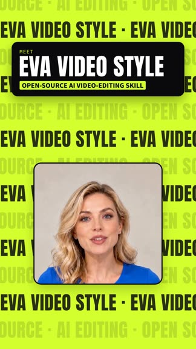 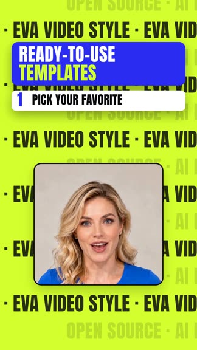

### T02 · Electric Blue Console · 电光蓝控制台
Lime display type and the 2×2 style cards on navy; presenter card or circle below.
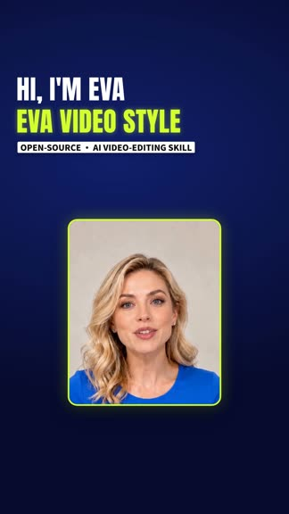 

### T03 · Dark 3D Stage · 暗黑 3D 舞台
Tilted 3D screens playing your footage on the orange-lit stage; presenter below.
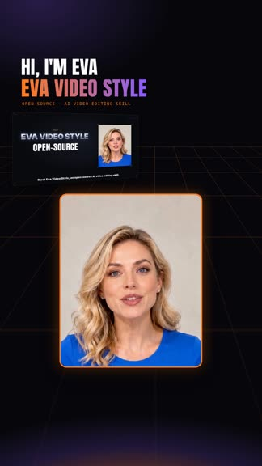 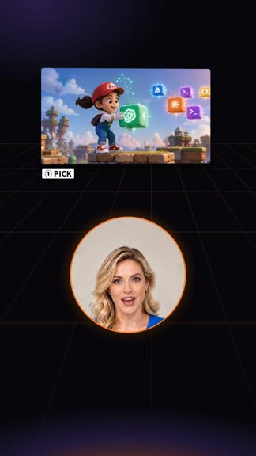

### T04 · Paper · 纸张
Dot-grid paper, colour tiles, stamps and the check list; presenter below.
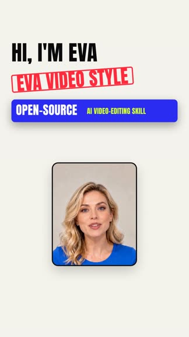 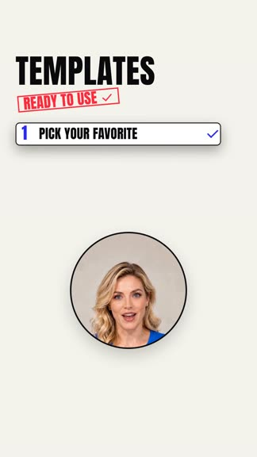

### T05 · Red Sunburst · 红色放射
Rotating red rays fill the frame; yellow headlines and numbered steps on top, presenter circle below.
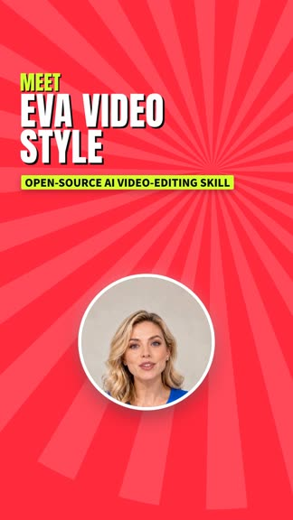 

### T06 · Brand Purple · 品牌紫
Purple gradient, style cards and the product shot; presenter below.
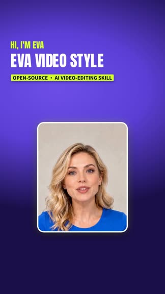 

### T07 · Cartoon Eva · 卡通 Eva
Cartoon footage fills the 9:16 frame, rounded lettering in the sky, framed clip cards; presenter circle below.
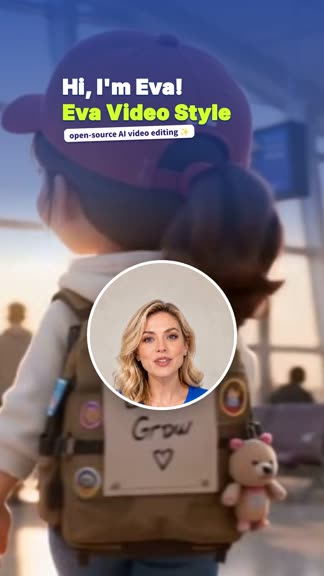 

### T08 · Neon Explainer · 霓虹讲解
Pixel title, then a full-bleed neon-graded presenter with glowing text below her face; article card and diagram later.
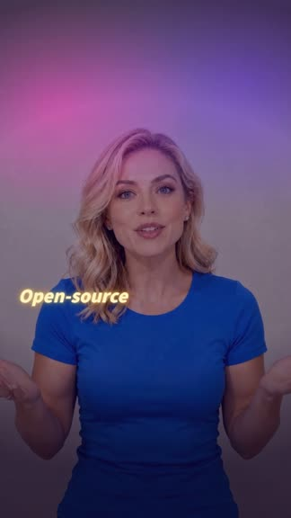 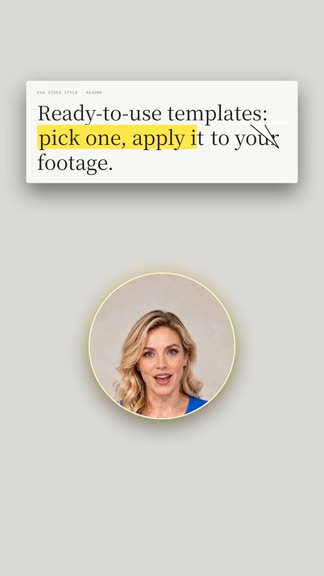

### T09 · Showcase Wall Opener · 作品墙开场
A tall 3D wall of playing video slices sweeps past, the counter rolls, then HUD titles with the presenter card below.
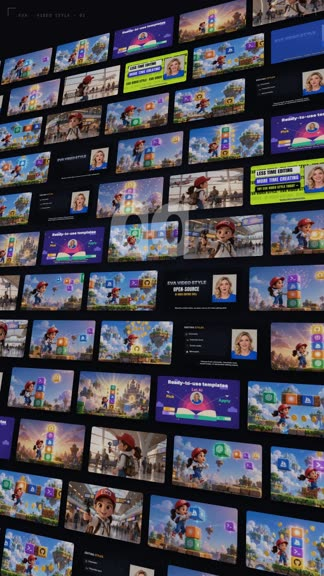 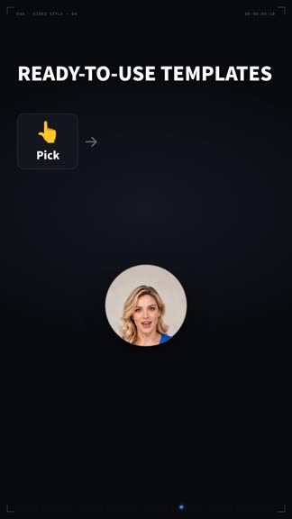

### T10 · HUD Keynote · HUD 发布会
HUD frame, BREAKING tag, glowing curve, globe, metallic hero title; presenter card or circle below.
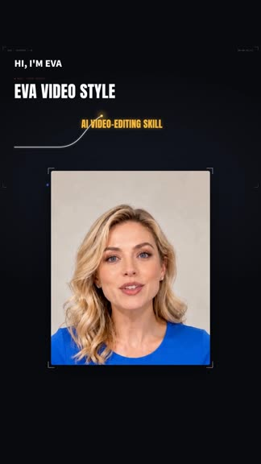 

### T11 · HUD Dashboard · HUD 仪表盘
Terminal, progress bars, flow tiles and toggles; presenter below.
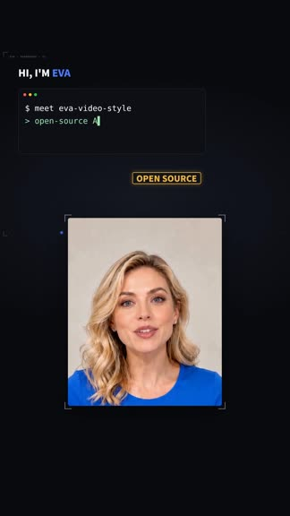 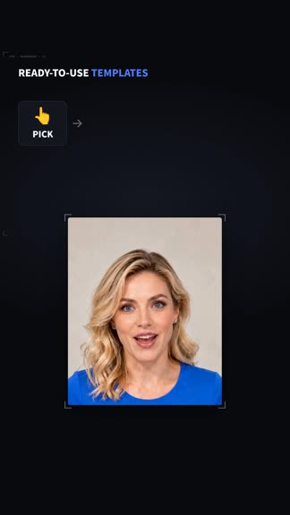

### T12 · Old Newspaper · 旧报纸
Masthead, film strip with your footage, typed notes and red marks; presenter photo card below.
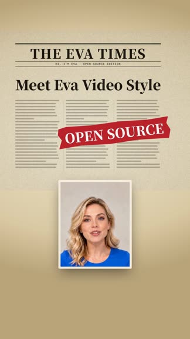 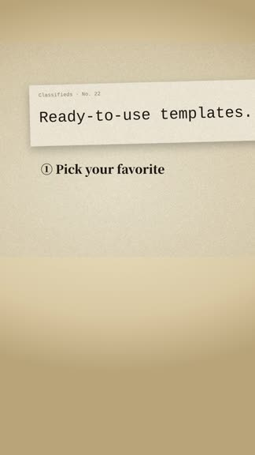

### T13 · Tech Blue · 科技蓝
Tech frame, serif titles, numbered style list and column cards; presenter below.
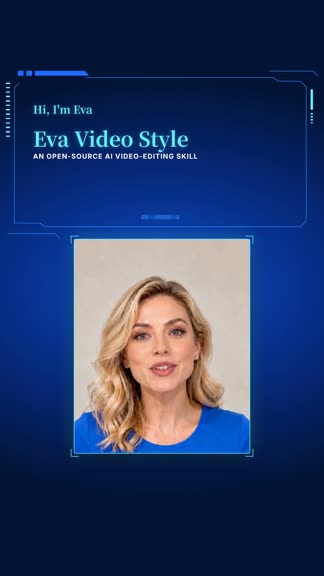 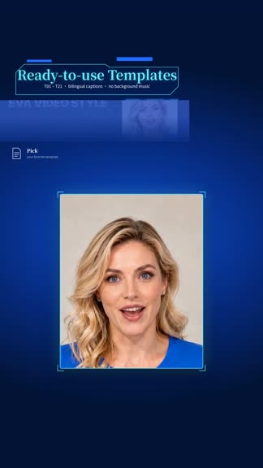

### T14 · Future Style · 未来科技
The neon grid floor covers the whole frame; the presenter sits inside the spinning globe and the torus ring.
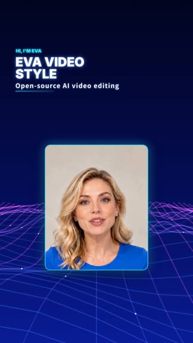 

### T15 · Learning Style · 学习风
Starry purple sky across the frame, rounded lettering, books and the sun with the presenter inside.
 

### T16 · Comic Pop · 漫画风
Comic rays and the zigzag split fill the frame; speech clouds, stickers, presenter card or circle.
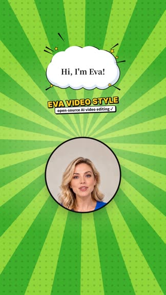 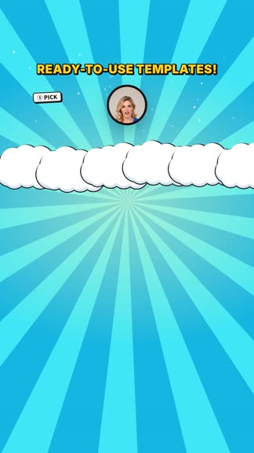

### T17 · Science Network · 科学风
Plexus ribbon, globe, sphere chain and tunnel re-centred for 9:16; the circle presenter moves between beats.
 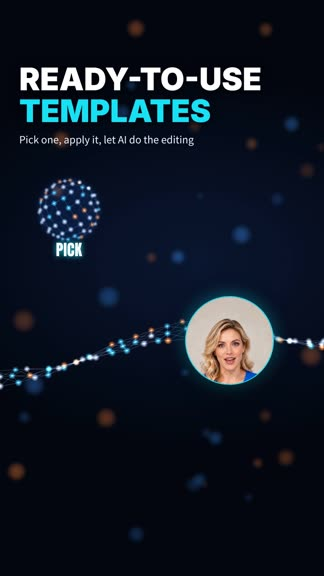

### T19 · Footage Intro · 真实影像引入
Cut-out presenter over fast-swapping footage, then she shrinks into a circle that keeps the footage clear; end card.
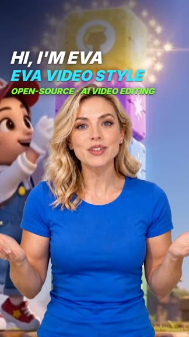 

### T20 · Fast-Paced Social Media · 快节奏社媒
Stickers, speed type and the kinetic caption bar; full-bleed beat-cut punches with a segmented progress bar.
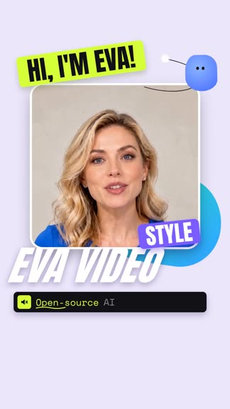 

### T21 · Clean & Minimal · 简洁极简
Quiet serif lines on warm paper; presenter circle or card below.
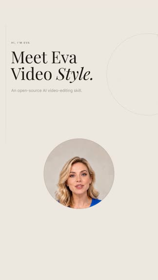 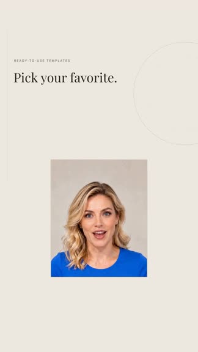

### T23 · Creative Pop · 创意波普
Seven-colour pills, step path and hub; the presenter sits inside the hub.
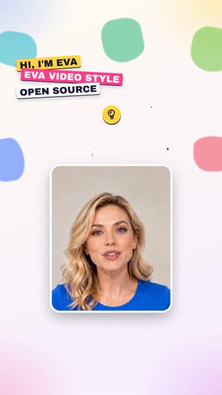 

### T24 · Luxury Nude Motion · 奢华裸色
Nude stage, 3D white type and ivory cards in the top zone; the cut-out presenter stands lower and centred.
 

### T26 · Real Estate Social · 房产种草 (vertical only)
Cut-out presenter with a white sticker outline over real property footage (one shot per spoken line); heavy dark
headline with a red phrase, yellow brush underline and sparks, red hearts, icon list that builds as each point is spoken.
On-screen text comes only from the SRT; property facts appear only when supplied.
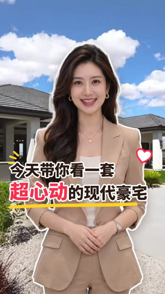 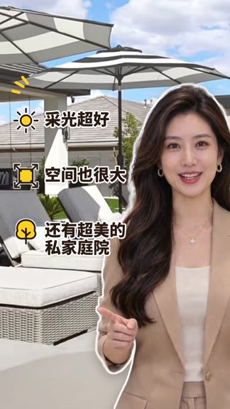

## Not yet vertical

- Burned captions (`scripts/captions.py`) still use the 16:9 style; the caption zone above is reserved for them.
- The SaaS cloud pipeline still accepts landscape input only.
- Reference pages `template/cards/layouts` and `template/sample5/t24-layouts` are 16:9 only.

Technical details: [`responsive-layout.md`](responsive-layout.md).
